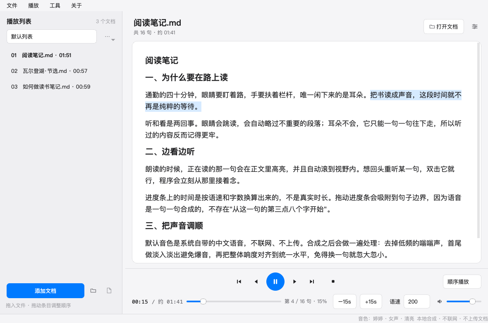

# 文档朗读器

macOS 上的离线文档朗读工具：把 txt / Markdown / PDF / Word 读给你听，读到哪句高亮哪句，关掉再打开能接着上次那句。

不联网、不上传、不需要注册。语音由系统合成，音频在本机生成。



## 特性

- **边看边听**：当前句在正文里高亮并自动滚动，双击任意句子从那里开始读
- **多格式**：txt、Markdown、PDF、Word，以及代码/日志/配置等纯文本文件
- **播放列表**：多个列表切换、拖动排序、顺序/循环/单曲/随机
- **断点续读**：退出时记住读到第几句，下次打开直接续上
- **双坐标进度条**：时间是按语速和字数换算的估值，已经合成过的句子用真实时长替换，越听越准；拖动会吸附到句子边界
- **口播改写**：数字、日期、符号自动转成口语（技术类文档里自动关闭，避免把代码读成句子）
- **音频后处理**：低频嗡声滤除、首尾淡入淡出、整体响度归一化，长文档连播不会忽大忽小
- **可拖动分栏**：左栏宽度自由调整并记住
- **深浅色**：跟随系统外观

## 系统要求

- macOS 13 或更高
- 一个中文语音。系统设置 → 辅助功能 → 朗读内容 → 系统声音 → 管理声音，下载任一中文音色（「婷婷」是默认选择）

## 安装

### 下载现成的应用

到 [Releases](https://github.com/fuxm0818/md-file-reader/releases) 下载最新的 zip，解压后把 `文档朗读器.app` 拖进「应用程序」。

应用没有 Apple 开发者签名，首次打开需要右键 →「打开」，或在终端执行一次：

```bash
xattr -dr com.apple.quarantine /Applications/文档朗读器.app
```

### 从源码构建

```bash
git clone https://github.com/fuxm0818/md-file-reader.git
cd md-file-reader
python3 -m venv .venv
.venv/bin/pip install -r requirements.txt
./build.sh
```

产物在 `dist/文档朗读器.app`。`build.sh` 会用 PyInstaller 打成单文件夹应用并做临时签名，大约需要两三分钟。

只想直接跑源码：

```bash
.venv/bin/python src/main.py
```

## 使用

把文件或整个文件夹拖进左栏，或点「添加文档」。双击列表项开始朗读。

| 操作 | 快捷键 |
| --- | --- |
| 播放 / 暂停 | `空格` |
| 后退 / 前进 15 秒 | `⌃←` / `⌃→` |
| 上一项 / 下一项 | `⌃↑` / `⌃↓` |
| 添加文件 | `⌘O` |

正文里双击句子 = 从这句开始读；右键句子有同样的入口。「播放」菜单里还有逐句跳转。

## 几个设计取舍

**为什么用系统语音，而不是神经 TTS。** 试过随包分发一个小型神经 TTS 模型，实际听感并不比系统中文语音好，包体积却从 190 MB 涨到 540 MB，还要为不同机型准备推理运行时。这个工具的价值在「边看边听」的流程，不在音色，所以语音交给系统，把体积和启动速度留给别处。

**为什么一句一句合成。** 整篇合成要等很久才能出声，而且没法跳读。按句合成可以随时从任意一句开始，代价是句子之间有微小间隙——用句尾补静音的方式抹平，实际连播听不出断点。

**为什么进度条上的时间是估的。** 音频是按需生成的，播放到那句之前并不存在，所以整篇总时长无法预先知道。程序按当前语速的字数换算，每合成一句就用真实时长替换估值，进度条会随播放越来越准。

**为什么切句不爆音。** 每段音频首尾都做了 8 ms 淡入淡出，否则波形从非零值突变成零，会有「啪」的一声。

## 项目结构

```
src/
  main.py              入口，含自检（SELFTEST）与链路诊断（DIAG）两个环境变量入口
  controller.py        播放调度：取句、合成、缓存、进度、断点
  core/
    parsers.py         各格式 → 段落/句子模型
    speech.py          say 合成 + 磁盘缓存
    loudness.py        音频后处理：高通、去静音、淡入淡出、响度对齐
    prosody.py         停顿与语调（say 的内嵌命令）
    oralizer.py        口播改写：数字、单位、符号
    textclean.py       朗读前剔除不可读符号
    timeline.py        双坐标进度换算
    voices.py          音色档案与可读名称
    store.py           状态文件、播放列表、设置
  ui/
    main_window.py     主窗口、分栏、菜单
    playlist_view.py   左栏列表
    reader_view.py     正文渲染与句级高亮
    controls.py        底部播放控制栏
    settings_dialog.py 偏好设置
    theme.py           设计令牌、样式表、矢量图标
scripts/
  make_icon.py         生成 assets/AppIcon.icns（QPainter 绘制）
  make_screenshot.py   生成 README 截图（隔离状态，不碰真实数据）
tests/
  run_qa.py            测试唯一入口
  e2e/                 用例实现
  docs/                用例规格、质量门禁、执行记录
samples/               各格式的示例文档
```

数据都在 `~/Library/Application Support/文档朗读器/`：`state.json` 存播放列表和设置，`cache/` 存合成过的音频（超过 500 MB 会自动清理最旧的，也可以在设置里手动清空）。

## 测试

```bash
QT_QPA_PLATFORM=offscreen .venv/bin/python tests/run_qa.py
```

一条命令跑完全部端到端用例并输出覆盖率与安全用例结果。用例规格写在 `tests/docs/0*-TEST-CASES.md`，行数与「有多少条用例」无关，改代码后先改规格。当前 82 条用例全绿，覆盖率约 86%。

打包产物可以单独验证：

```bash
DOCREADER_SELFTEST=1 dist/文档朗读器.app/Contents/MacOS/文档朗读器   # 应输出 ok: true
DOCREADER_DIAG=1     dist/文档朗读器.app/Contents/MacOS/文档朗读器   # 逐段报告语音链路
```

## 已知限制

- 只支持 macOS，语音接口是系统 `say`
- 扫描版 PDF（没有文字层）读不出内容，列表里会标成「不可读」并跳过
- 超长单句（几百字无标点）会被当成一句合成，中间无法跳转
- 音色取决于系统装了哪些；没有中文音色时应用会提示去下载

## 许可证

[MIT](LICENSE)。用、改、商用、闭源分发都可以，保留版权声明即可。
